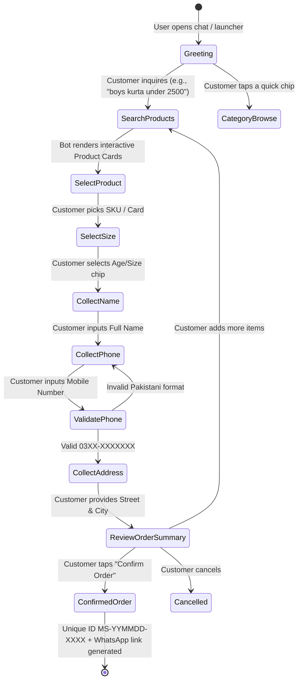

# Maa Sadqay AI Order-Taker Chatbot Specification

This document details the conversational state machine, tool definitions, validation logic, and safety guardrails of the **Maa Sadqay AI Order Assistant**.

---

## 1. Conversational Flow Diagram



---

## 2. Tool Definitions & Schemas

### 1. `search_products`
Searches the local typed repository (`catalog.ts`) using fuzzy matching on name, sku, tags, age, and price constraints.
```typescript
{
  name: "search_products",
  description: "Searches the Maa Sadqay catalog for available clothing items",
  parameters: {
    type: "object",
    properties: {
      query: { type: "string", description: "Search keyword e.g. kurta, co-ord, BCSRC20" },
      category: { type: "string", enum: ["boys", "girls", "toddlers", "women", "accessories", "sale"] },
      max_price: { type: "number", description: "Maximum budget in PKR" },
      size: { type: "string", description: "Age or size e.g. 3-4Y, 6-12M" }
    }
  }
}
```

### 2. `calculate_order_pricing`
Computes accurate subtotal, applies shipping rules, and returns the total payable in code.
```typescript
{
  name: "calculate_order_pricing",
  description: "Calculates subtotal, shipping fee, and grand total",
  parameters: {
    type: "object",
    properties: {
      items: {
        type: "array",
        items: {
          properties: {
            productId: { type: "string" },
            quantity: { type: "number" },
            unitPrice: { type: "number" }
          }
        }
      }
    }
  }
}
```
*Rule: If subtotal >= Rs. 10,000, shipping is Rs. 0 (Free). Otherwise, shipping is flat Rs. 250 nationwide.*

### 3. `create_order`
Validates customer details and commits the order to `/api/orders`.
```typescript
{
  name: "create_order",
  description: "Places a confirmed Cash on Delivery order",
  parameters: {
    type: "object",
    required: ["items", "fullName", "phoneNumber", "city", "address"],
    properties: {
      fullName: { type: "string" },
      phoneNumber: { type: "string", pattern: "^(?:(?:\\+92|92)|0)?(3[0-9]{9})$" },
      city: { type: "string" },
      address: { type: "string" },
      paymentMethod: { type: "string", default: "COD" }
    }
  }
}
```

---

## 3. Pakistani Input Validation Rules

### Mobile Phone Formats
Valid formats accepted by the bot and order API:
- `0300-1234567` (Standard formatted)
- `03154245424` (Direct 11 digits)
- `+923001234567` (International notation)
- `0333 9876543` (Spaced)

Invalid numbers (landlines, foreign numbers, or truncated inputs) trigger an immediate gentle retry prompt.

### Unique Order Identification Format
Every placed order generates a human-readable identifier:
`MS-YYMMDD-XXXX`
- `MS`: Maa Sadqay Prefix
- `YYMMDD`: 2-digit Year, Month, Day
- `XXXX`: 4 uppercase alphanumeric unique random characters (e.g. `MS-261114-K9W2`)

---

## 4. Multilingual & Safety Guardrails

1. **Multilingual Recognition:** The bot recognizes English, Urdu, and Roman Urdu (e.g., *"mujhe 3 saal k larkay k liye kurta chahye"*, *"delivery kitne din me hoti hai"*).
2. **Zero Hallucination:** Prices, stock availability, and shipping rules are queried strictly via tools/code. The model never fabricates prices.
3. **Prompt Injection Defense:** Unrelated prompts, programming queries, or attempts to extract system prompts are politely deflected back to Maa Sadqay shopping.
4. **WhatsApp Fallback:** Any customer confusion or failed API call surfaces a one-tap button to human assistance at **0315-4245424**.
